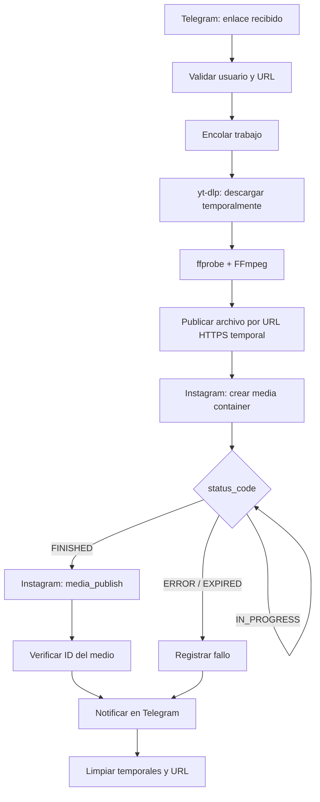

# Instagram Reposter — Especificación del MVP y prueba aislada de publicación

**Estado:** publicación aislada validada el 2026-11-04; integración pendiente. Prueba local en Windows/Python 3.14; destino Linux/Python 3.12+.

> **Actualización operativa:** leer primero [03_ESTADO_VALIDADO_Y_OPERACION.md](03_ESTADO_VALIDADO_Y_OPERACION.md). La cuenta `@tula.posting` usa inicio de sesión **unificado** y funcionó con `graph.facebook.com`, no con el flujo Instagram Login supuesto en este diseño original. Los comandos vigentes están en el documento 03 y los scripts reales; los ejemplos de este documento son antecedentes de diseño.

## 1. Objetivo

Construir una aplicación personal que reciba enlaces de Reels mediante Telegram, obtenga una copia de medios autorizados, los adapte técnicamente y los publique en una cuenta profesional de Instagram mediante **la API oficial de Meta**. En esta primera fase, **probar la publicación sin Telegram ni yt-dlp**, con un MP4 propio de prueba: aislar la incertidumbre principal antes de integrar el resto.

La cuenta está categorizada como «Arte» y se describe como profesional. **Confirmar** que su tipo real sea **Business o Creator**; la categoría no basta para verificarlo.

### Alcance del MVP

- Una cuenta de Instagram de destino, controlada por el operador.
- Publicación de un único Reel MP4 con caption prefijado.
- Servidor propio Linux, archivo temporal servido por HTTPS y borrado seguro después del resultado.
- Procesamiento de estados de la API y registro de IDs de contenedor y medio.
- Segunda fase: entrada por Telegram, descarga con yt-dlp, FFmpeg, cola persistente y notificaciones.

### Fuera del alcance inicial

- Gestión multiusuario, carruseles, Stories, publicación en lote, panel web, reconocimiento de contenido.
- Reproducir o eludir restricciones de descarga de Instagram o republicar material sin autorización. La visibilidad pública de un Reel no concede automáticamente licencia de republicación.
- Automatizar una cuenta personal con APIs privadas.

## 2. Decisiones técnicas

| Decisión | Elección inicial | Justificación |
|---|---|---|
| Publicación | Instagram API con **inicio de sesión unificado** | Flujo real configurado en la app y probado con publicación. |
| Permisos | Autorización de publicación comprobada; lista exacta pendiente | Revisar los permisos del flujo unificado en Meta; no copiar los `instagram_business_*` del diseño inicial. |
| Transporte de medios | `video_url` HTTPS servido desde Linux | Camino más simple para el primer ensayo. Meta obtiene el archivo mediante HTTP. |
| Exposición | Nginx + ruta de nombre aleatorio; TLS válido | Evita necesidad inicial de almacenamiento externo. |
| Cliente HTTP | `requests` | Sencillo para depurar llamadas. |
| Estado | SQLite en fase integrada | Reanudación y deduplicación. |
| Versión Graph API | Variable `GRAPH_API_VERSION` | No fijar una versión que pueda caducar; utilizar una versión actualmente soportada. |

**Importante:** esta app utiliza inicio unificado y el host probado es `graph.facebook.com`. El flujo Instagram Login sobre `graph.instagram.com` fue la suposición inicial y falló con el token disponible. No asumir que se necesita un token de página: conservar el token que funcionó. Los bloques de código históricos de este documento muestran el diseño original; utilizar los scripts reales y el documento 03 para operar.

## 3. Requisitos previos

1. Acceso SSH al servidor Linux; Python 3.12+, `venv`, `curl`, `ffmpeg`, `ffprobe`, Nginx, dominio y certificado TLS válido.
2. Cuenta Instagram profesional Creator/Business y permiso legítimo de publicar en ella.
3. Aplicación configurada en [Meta for Developers](https://developers.facebook.com/apps/), con caso de uso de Instagram y producto **Instagram API with Instagram Login**.
4. Usuario autorizado dentro de la aplicación y permisos de publicación concedidos. En modo desarrollo, revisar roles y cuentas de prueba; consultar requisitos actuales para producción.
5. `IG_USER_ID`, `IG_ACCESS_TOKEN` válido y versión Graph soportada. No publicar tokens en repositorios, URLs, capturas o registros.
6. MP4 propio de unos segundos que cumpla especificaciones técnicas de Reel.
7. Un hostname HTTPS accesible **desde los servidores de Meta** (localhost, `127.0.0.1`, rutas `file://` y direcciones privadas no sirven para `video_url`).

## 4. Arquitectura del proyecto



**La prueba de esta primera fase empieza en E/F**, suministrando un MP4 preparado. La arquitectura completa y el código de integración se detallan en `02_GUIA_INTEGRACION.md`.

## 5. Estructura mínima para la prueba

```text
instagram-reposter/
├── .env                     # secretos, nunca versionar
├── .env.example             # variables sin valores secretos
├── .gitignore
├── requirements.txt
├── scripts/
│   └── publish_test.py
└── tmp/                     # temporales no versionados
```

Ejemplo de `.env.example`:

```dotenv
IG_USER_ID=123456789012345
IG_ACCESS_TOKEN=REEMPLAZAR
GRAPH_API_VERSION=vXX.X
PUBLIC_MEDIA_URL=https://media.ejemplo.cl/reels/TOKEN_ALEATORIO.mp4
REEL_CAPTION=Prueba técnica de publicación
SHARE_TO_FEED=false
```

`requirements.txt`:

```text
requests>=2.32,<3
python-dotenv>=1,<2
```

`.gitignore`:

```gitignore
.env
.venv/
__pycache__/
tmp/
*.sqlite3
```

Instalación:

```bash
python3 -m venv .venv
source .venv/bin/activate
pip install -r requirements.txt
```

## 6. Preparación del video y URL pública temporal

Para la primera prueba usar un archivo propio, por ejemplo `test-input.mp4`:

```bash
ffmpeg -y -i test-input.mp4 \
  -map 0:v:0 -map 0:a:0? \
  -c:v libx264 -pix_fmt yuv420p -preset medium -crf 21 \
  -vf 'scale=1080:1920:force_original_aspect_ratio=decrease,pad=1080:1920:(ow-iw)/2:(oh-ih)/2' \
  -r 30 -c:a aac -b:a 128k -ar 48000 \
  -movflags +faststart test-ready.mp4
ffprobe -v error -show_entries format=duration,size -show_entries stream=codec_type,codec_name,width,height,r_frame_rate -of json test-ready.mp4
```

> Si la entrada no tiene pista de audio, el mapeo opcional `0:a:0?` no la crea. Verificar requisitos efectivos antes de subir; agregar pista silenciosa si corresponde. Validar duración y tamaño contra los requisitos **vigentes** de la API.

**Configuración Nginx sugerida:** mapear una carpeta exclusiva, fuera de cualquier directorio de archivos personales. Por ejemplo, servir `/srv/instagram-reposter/public/` como `https://media.ejemplo.cl/reels/`:

```nginx
server {
    listen 443 ssl;
    server_name media.ejemplo.cl;
    # Configurar ssl_certificate y ssl_certificate_key con certificados válidos.
    location /reels/ {
        alias /srv/instagram-reposter/public/;
        autoindex off;
        limit_except GET HEAD { deny all; }
        add_header X-Content-Type-Options nosniff always;
        types { video/mp4 mp4; }
        default_type application/octet-stream;
    }
}
```

Este bloque es **parcial**: completar TLS, restricciones de otros virtual hosts y permisos del sistema según tu distribución. No activar listado de directorios. Un nombre aleatorio reduce el descubrimiento accidental, **no convierte el recurso en estrictamente privado**. Evitar firewalls que bloqueen a Meta y asegurarse de que la URL no requiera login/cookies.

```bash
sudo mkdir -p /srv/instagram-reposter/public
# Copiar con nombre impredecible, p. ej. generado con secrets.token_urlsafe(24)
# Probar acceso desde fuera de la red:
curl -I https://media.ejemplo.cl/reels/TOKEN_ALEATORIO.mp4
```

La respuesta esperada es `200 OK` con un tipo de contenido compatible; confirmar una descarga completa mediante `curl`, no solo HEAD. Mantener el recurso hasta que Meta termine de procesar el contenedor. Eliminarlo cuando el proceso termine o exista una política de vencimiento.

## 7. Script de prueba de publicación

Archivo `scripts/publish_test.py`:

```python
import os
import sys
import time
import requests
from dotenv import load_dotenv

load_dotenv()
TOKEN = os.environ['IG_ACCESS_TOKEN']
IG_ID = os.environ['IG_USER_ID']
VERSION = os.environ['GRAPH_API_VERSION']  # Ej.: vXX.X, sustituir por versión vigente
VIDEO_URL = os.environ['PUBLIC_MEDIA_URL']
CAPTION = os.getenv('REEL_CAPTION', 'Prueba técnica')
BASE = f'https://graph.instagram.com/{VERSION}'
HEADERS = {'Authorization': f'Bearer {TOKEN}'}


def call(method, path, *, data=None, params=None):
    r = requests.request(method, f'{BASE}/{path}', headers=HEADERS,
                         data=data, params=params, timeout=40)
    try:
        r.raise_for_status()
    except requests.HTTPError:
        print(f'Error HTTP {r.status_code}: {r.text[:1000]}', file=sys.stderr)
        raise
    return r.json()


def main():
    me = call('GET', 'me', params={'fields': 'id,username'})
    print('Cuenta autenticada:', me)

    container = call('POST', f'{IG_ID}/media', data={
        'media_type': 'REELS',
        'video_url': VIDEO_URL,
        'caption': CAPTION,
        'share_to_feed': os.getenv('SHARE_TO_FEED', 'false').lower(),
    })
    container_id = container['id']
    print('Container ID:', container_id)

    deadline = time.monotonic() + 15 * 60
    while time.monotonic() < deadline:
        state = call('GET', container_id, params={'fields': 'status_code,status'})
        status = state.get('status_code')
        print('Estado:', status, state.get('status'))
        if status == 'FINISHED':
            break
        if status in {'ERROR', 'EXPIRED'}:
            raise RuntimeError(f'Contenedor no publicable: {state}')
        time.sleep(10)
    else:
        raise TimeoutError(f'Contenedor {container_id} sin FINISHED; investigar antes de reintentar')

    # ¡ATENCIÓN! Si esta petición termina en timeout, consultar si se creó el medio
    # antes de volver a ejecutar todo el script: media_publish no se debe reintentar a ciegas.
    published = call('POST', f'{IG_ID}/media_publish', data={'creation_id': container_id})
    media_id = published['id']
    print('Publicado media ID:', media_id)
    details = call('GET', media_id, params={'fields': 'id,permalink'})
    print('Permalink:', details.get('permalink', '(no devuelto)'))


if __name__ == '__main__':
    main()
```

**Ejecutar**:

```bash
python scripts/publish_test.py
```

**Nota sobre verificación:** el ejemplo separa el `IG_USER_ID` del resultado de `/me` deliberadamente; deben referirse a la misma cuenta autorizada. Si el endpoint devuelve errores de permisos o versión, verificar en el dashboard la configuración exacta del producto Instagram Login. No sustituir automáticamente por endpoints `graph.facebook.com`: corresponden a otro flujo de autenticación.

## 8. Casos de prueba y criterios de aceptación

| Caso | Entrada | Resultado esperado |
|---|---|---|
| A1 autenticación | Token válido | ID/usuario correcto en `/me`. |
| A2 transferencia HTTPS | URL pública temporal | Meta puede descargar el MP4. |
| A3 creación | POST `/media` | Se recibe `container_id`. |
| A4 procesamiento | Poll `/container_id` | `FINISHED` dentro del plazo definido. |
| A5 publicación | POST `/media_publish` | Se recibe `media_id` y se comprueba el Reel en la cuenta. |
| A6 falla de formato | Video inválido | Error controlado, no se publica nada. |
| A7 vencimiento | URL inaccesible | Error registrado, archivo retenido temporalmente para diagnóstico. |
| A8 limpieza | Publicación confirmada | URL temporal deja de estar disponible y el MP4 es borrado. |

**Criterio de aprobación:** un Reel propio se publica mediante la API oficial sin pasos manuales después de iniciar el script, con ID verificable y limpieza del archivo. Si falla, documentar request ID/error, endpoint, estado y causa sin registrar tokens.

## 9. Consideraciones operacionales

- Usar la cuota de la cuenta obtenida del endpoint oficial `/content_publishing_limit` si está disponible para el producto y versión elegidos. **No hardcodear 50 ni 100 publicaciones/día**: el límite efectivo puede variar por versión y documentación.
- Metadatos mínimos: fecha, `container_id`, `media_id`, URL de origen y estado. Nunca almacenar el token en SQLite ni logs.
- Timeout no significa necesariamente fallo: puede haberse publicado pese a la pérdida de respuesta. Implementar reconciliación antes de reintentos.
- Renovar tokens de larga duración según las reglas vigentes del producto; configurar alerta de expiración.
- No eliminar un archivo **mientras Meta todavía lo está obteniendo**. Limpiar también trabajos abandonados mediante un proceso periódico con TTL.
- No exponer el servicio a enlaces arbitrarios para evitar SSRF en descargas; aceptar exclusivamente hosts/rutas de Instagram previstos.

## 10. Orden de implementación

1. Confirmar Business/Creator, elegir Instagram Login, crear app y obtener token.
2. Publicar MP4 de prueba por HTTPS en Linux.
3. Ejecutar `publish_test.py` y verificar resultado.
4. Documentar permisos, errores reales y cuotas devueltas por Meta.
5. Solo después comenzar integración de Telegram/yt-dlp/FFmpeg descrita en documento 02.

## Fuentes técnicas

- [Meta — Instagram API (colección oficial de Postman)](https://www.postman.com/meta/instagram/documentation/6yqw8pt/instagram-api)
- [Meta — Instagram API, flujo Instagram Login](https://www.postman.com/meta/instagram/documentation/6yqw8pt/instagram-api?entity=request-23987686-3fe78620-2258-44b6-893f-42d76c7200d7)
- [Meta — Publicación de Reels: creación, estado, publicación](https://www.postman.com/meta/instagram/documentation/6yqw8pt/instagram-api?entity=request-23987686-15c537cd-a773-4b40-a87c-27829e49a439)

> **Vigencia:** APIs, permisos, restricciones de archivo y cuotas cambian. La publicación real ya se ejecutó y comprobó; ver resultados, corrección del flujo de login y límites de la validación en el documento 03. El código ilustrativo anterior no sustituye a `scripts/publish_test.py`.
