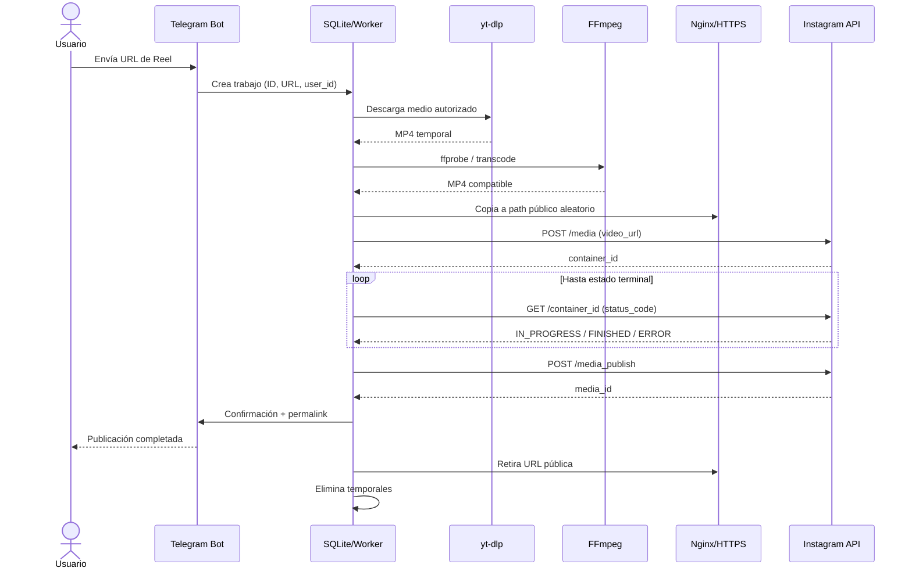

# Instagram Reposter — Arquitectura integrada y guía de implementación

**Estado:** publicación aislada comprobada; integración aún en diseño · **Fecha:** 2026-11-04

> **Punto de continuación:** [03_ESTADO_VALIDADO_Y_OPERACION.md](03_ESTADO_VALIDADO_Y_OPERACION.md) registra la autenticación por token, publicación exitosa, descripción con `--caption` y estado de yt-dlp/cookies. El publisher debe conservar el inicio de sesión **unificado** probado sobre `graph.facebook.com`. Los módulos `src/` de esta guía aún no están implementados.

**Dependencia:** completar primero `01_ESPECIFICACION_MVP.md` y demostrar publicación con un MP4 propio. Esta guía conecta **Telegram → Python → yt-dlp → FFmpeg → HTTPS → Instagram API → limpieza**.

## 1. Comportamiento esperado

1. El operador comparte un enlace `https://www.instagram.com/reel/.../` al bot privado de Telegram.
2. El bot comprueba `user_id` permitido, URL y si ese origen ya se publicó.
3. Se crea un trabajo en SQLite con estado `RECEIVED`.
4. El worker descarga el medio con `yt-dlp` **solo si está disponible y existe autorización de reutilización**.
5. `ffprobe` inspecciona duración, codecs, audio y tamaño; FFmpeg transcodifica si hace falta.
6. Se copia el MP4 a una ruta HTTPS temporal con nombre criptográficamente aleatorio.
7. Se crea un Reel container mediante el flujo unificado probado, sobre `graph.facebook.com`.
8. Se consulta su estado hasta `FINISHED` o error; luego se ejecuta `media_publish` **una sola vez** salvo reconciliación demostrada.
9. Se registra el ID/permalink de Instagram, se notifica el resultado por Telegram y se borran los archivos localmente, en un bloque `finally` condicionado por el estado.
10. Un reconciliador limpia trabajos atascados y URLs vencidas, sin volver a publicar a ciegas.

## 2. Diagrama de secuencia



## 3. Stack seleccionado

| Capa | Tecnología | Razón |
|---|---|---|
| Runtime | Python 3.12+ | Código sencillo, operativo en Linux. |
| Bot | `python-telegram-bot` | Long polling para evitar exponer webhook al principio. |
| Descarga | `yt-dlp` | Extractor de medios: disponibilidad de Instagram no garantizada. |
| Inspección | `ffprobe` | Metadatos técnicos sin transcodificación. |
| Conversión | `ffmpeg` | H.264/AAC/MP4, `faststart`, escalado opcional. |
| Publicación | `requests` + Meta Instagram API | Endpoints oficiales. |
| Web | Nginx + TLS | URL de medios descargable por Meta. |
| Persistencia | SQLite (WAL) | Histórico, deduplicación, reanudación. |
| Servicio | systemd | Reinicio y logs de daemon. |

**Por ahora no son necesarios:** FastAPI, Redis, Celery, Docker, S3. Pueden añadirse cuando haya carga real.

## 4. Organización de archivos

```text
instagram-reposter/
├── README.md
├── .env
├── .env.example
├── requirements.txt
├── src/
│   ├── bot.py              # escucha y validación de remitentes
│   ├── config.py           # variables y validaciones
│   ├── db.py               # jobs, deduplicación, estados
│   ├── downloader.py       # yt-dlp
│   ├── media.py            # ffprobe / FFmpeg
│   ├── publisher.py        # Instagram API
│   ├── worker.py           # orquestación
│   └── cleanup.py          # borrado y recolección TTL
├── scripts/
│   └── publish_test.py     # heredado del documento 01
├── data/
│   └── jobs.sqlite3
└── tmp/
    └── <job_id>/          # temporales por trabajo
```

La raíz pública del servidor se aloja **fuera** del código: `/srv/instagram-reposter/public/`. Crear rutas por trabajo evita que archivos de diferentes publicaciones se sobreescriban.

## 5. Instalación Linux

Ejemplo para Debian/Ubuntu (adaptar si usas otra distribución):

```bash
sudo apt update
sudo apt install -y python3 python3-venv python3-pip ffmpeg nginx
mkdir -p ~/instagram-reposter/{src,data,tmp,scripts}
cd ~/instagram-reposter
python3 -m venv .venv
source .venv/bin/activate
pip install 'python-telegram-bot>=21,<23' 'yt-dlp' 'requests>=2.32,<3' 'python-dotenv>=1,<2'
```

Instalar versión disponible de Python >=3.12 y fijar versiones exactas una vez validado el primer deploy. `yt-dlp` evoluciona con los cambios de los extractores; actualizarlo separadamente y probar.

Archivo `.env.example`:

```dotenv
TELEGRAM_BOT_TOKEN=REEMPLAZAR
TELEGRAM_ALLOWED_USER_ID=123456789
IG_ACCESS_TOKEN=REEMPLAZAR
IG_USER_ID=123456789012345
GRAPH_API_VERSION=vXX.X
PUBLIC_DIR=/srv/instagram-reposter/public
PUBLIC_BASE_URL=https://media.ejemplo.cl/reels
TMP_DIR=/home/usuario/instagram-reposter/tmp
DATABASE_PATH=/home/usuario/instagram-reposter/data/jobs.sqlite3
REEL_CAPTION_PREFIX=Guardado en mi galería (con autorización)
```

`.env` con permisos `0600`; nunca compartir tokens de Telegram/Meta. Crear usuario Linux específico sin privilegios de administrador y conceder escritura solo a las carpetas necesarias.

## 6. Bot de Telegram

### Crear bot

1. Buscar [@BotFather](https://t.me/BotFather) en Telegram.
2. Ejecutar `/newbot`, elegir nombre y nombre de usuario terminado en `bot`.
3. Copiar el token generado en `.env`.
4. Obtener tu `user_id` de Telegram mediante un script de identificación controlado o API `getUpdates`; no confundir con username visible.
5. Para MVP utilizar **long polling** (`run_polling`), sin configurar webhook. Si existe uno previo, quitarlo antes.

Ejemplo mínimo `src/bot.py` (solo recibe, **no ejecuta** directamente procesos pesados en el event loop):

```python
import os
import re
import sqlite3
import uuid
from urllib.parse import urlparse
from dotenv import load_dotenv
from telegram import Update
from telegram.ext import ApplicationBuilder, CommandHandler, MessageHandler, ContextTypes, filters

load_dotenv()
TOKEN = os.environ['TELEGRAM_BOT_TOKEN']
ALLOWED = int(os.environ['TELEGRAM_ALLOWED_USER_ID'])
DB = os.environ['DATABASE_PATH']
PATTERN = re.compile(r'https?://[^\s<>]+')


def normalize_instagram_url(message: str) -> str | None:
    urls = PATTERN.findall(message)
    for raw in urls:
        raw = raw.rstrip('.,!);]')
        parsed = urlparse(raw)
        if parsed.scheme != 'https' or parsed.hostname not in {'instagram.com', 'www.instagram.com'}:
            continue
        parts = [p for p in parsed.path.split('/') if p]
        if len(parts) == 2 and parts[0] in {'reel', 'p'} and re.fullmatch(r'[A-Za-z0-9_-]+', parts[1]):
            return f'https://www.instagram.com/{parts[0]}/{parts[1]}/'
    return None


async def start(update: Update, context: ContextTypes.DEFAULT_TYPE):
    if update.effective_user.id != ALLOWED:
        return
    await update.message.reply_text('Envíame un enlace de Reel autorizado para publicar.')


async def receive(update: Update, context: ContextTypes.DEFAULT_TYPE):
    if update.effective_user.id != ALLOWED:
        return
    url = normalize_instagram_url(update.message.text or '')
    if not url:
        await update.message.reply_text('Envía una URL HTTPS de instagram.com/reel/...')
        return
    job_id = str(uuid.uuid4())
    try:
        with sqlite3.connect(DB, timeout=10) as conn:
            conn.execute('INSERT INTO jobs(id, source_url, telegram_chat_id, status) VALUES (?, ?, ?, ?)',
                         (job_id, url, update.effective_chat.id, 'RECEIVED'))
    except sqlite3.IntegrityError:
        await update.message.reply_text('Ese enlace ya está registrado.')
        return
    await update.message.reply_text(f'Trabajo aceptado: {job_id[:8]}')


app = ApplicationBuilder().token(TOKEN).build()
app.add_handler(CommandHandler('start', start))
app.add_handler(MessageHandler(filters.TEXT & ~filters.COMMAND, receive))
app.run_polling()
```

**Precaución:** el bot acepta un enlace solamente después de comprobar el identificador del remitente. No aceptar URLs externas ni permitir que una URL enviada termine usándose como destino de un fetch servidor arbitrario. `yt-dlp` puede descubrir URLs internas adicionales; ejecutar con permisos mínimos y sin acceso a secretos ajenos.

## 7. Base de datos SQLite

Migración inicial, ejecutar una vez (`sqlite3` CLI o `sqlite3.executescript`):

```sql
PRAGMA journal_mode=WAL;
CREATE TABLE IF NOT EXISTS jobs (
  id TEXT PRIMARY KEY,
  source_url TEXT NOT NULL UNIQUE,
  telegram_chat_id INTEGER NOT NULL,
  status TEXT NOT NULL,
  source_author TEXT,
  download_path TEXT,
  processed_path TEXT,
  public_filename TEXT,
  container_id TEXT,
  media_id TEXT,
  permalink TEXT,
  error TEXT,
  created_at TEXT DEFAULT CURRENT_TIMESTAMP,
  updated_at TEXT DEFAULT CURRENT_TIMESTAMP
);
CREATE INDEX IF NOT EXISTS idx_jobs_status ON jobs(status, created_at);
```

Estados definidos:

```text
RECEIVED -> DOWNLOADING -> DOWNLOADED -> PROCESSING -> READY
READY -> CREATING_CONTAINER -> PROCESSING_INSTAGRAM -> PUBLISHING -> PUBLISHED
                              \-> FAILED
PUBLISHING -> UNCERTAIN  (si timeout/resultado ambiguo)
FAILED/PUBLISHED -> CLEANED   (o conservar estado y agregar cleaned_at)
```

**Mejora recomendada:** separar `publication_status` y `cleanup_status`, ya que la limpieza no debería ocultar el resultado de la publicación. Para un MVP puedes mantener `PUBLISHED`/`FAILED` como estados terminales y añadir `cleaned_at`.

**Dedupe:** el campo `source_url UNIQUE` evita duplicados solo para URL canónica. Se puede añadir normalización de `shortcode` como clave. Una URL `p/` puede representar foto/carrusel; el MVP solo acepta Reels en el worker hasta implementar esos formatos.

## 8. Downloader: yt-dlp

**Estado actual:** el operador informa que hasta ahora no se le han solicitado cookies. Empezar sin ellas; evaluar sesión autorizada solo si una descarga futura la exige. yt-dlp no usa el token de Meta. «YouTube Upload» se interpreta provisionalmente como yt-dlp/`YoutubeDL`; no hay integración de publicación en YouTube. Ver aclaración y comandos locales en el documento 03.

`src/downloader.py`:

```python
from pathlib import Path
from yt_dlp import YoutubeDL


def download(url: str, job_dir: Path) -> Path:
    job_dir.mkdir(parents=True, exist_ok=True)
    opts = {
        'outtmpl': str(job_dir / 'source.%(ext)s'),
        'format': 'bv*+ba/b',
        'noplaylist': True,
        'restrictfilenames': True,
        'socket_timeout': 30,
        'retries': 2,
        'overwrites': False,
    }
    with YoutubeDL(opts) as ydl:
        result_code = ydl.download([url])
    if result_code != 0:
        raise RuntimeError('yt-dlp terminó con error')
    matches = [p for p in job_dir.glob('source.*') if p.suffix.lower() in {'.mp4', '.mkv', '.mov', '.webm'}]
    if len(matches) != 1:
        raise RuntimeError(f'Se esperaba un archivo de video, encontrados: {matches}')
    return matches[0]
```

`yt-dlp` puede no descargar publicaciones de Instagram por cambios en el sitio, autenticación, bloqueo de red o restricciones. **No garantizar extracción**, ni automatizar la evasión de medidas de acceso. Limitar espacio y duración; abortar si archivo excede tamaño configurado.

## 9. ffprobe y FFmpeg

Convertir a MP4 compatible de forma conservadora, incluso si un original tiene contenedor o codecs distintos. `src/media.py`:

```python
import json
import subprocess
from pathlib import Path


def probe(path: Path) -> dict:
    result = subprocess.run(
        ['ffprobe', '-v', 'error', '-show_format', '-show_streams', '-of', 'json', str(path)],
        capture_output=True, text=True, check=True, timeout=45,
    )
    return json.loads(result.stdout)


def normalize_video(source: Path, output: Path) -> Path:
    metadata = probe(source)
    if not any(s.get('codec_type') == 'video' for s in metadata.get('streams', [])):
        raise ValueError('Archivo sin video')
    output.parent.mkdir(parents=True, exist_ok=True)
    cmd = [
        'ffmpeg', '-nostdin', '-y', '-i', str(source),
        '-map', '0:v:0', '-map', '0:a:0?',
        '-vf', 'scale=1080:1920:force_original_aspect_ratio=decrease,'
               'pad=1080:1920:(ow-iw)/2:(oh-ih)/2,setsar=1',
        '-r', '30', '-c:v', 'libx264', '-pix_fmt', 'yuv420p',
        '-preset', 'medium', '-crf', '21',
        '-c:a', 'aac', '-b:a', '128k', '-ar', '48000',
        '-movflags', '+faststart', str(output),
    ]
    subprocess.run(cmd, check=True, timeout=1200)
    return output
```

**Reglas adicionales:** validar tamaño y duración antes y después; si no hay audio, decidir si agregar pista AAC silenciosa. Evitar escalado excesivo de videos horizontales; el padding es una decisión del MVP. En producción, **no transcodificar** cuando el archivo ya cumpla especificaciones, para ahorrar CPU y preservar calidad.

## 10. Publisher: Instagram oficial

El módulo `src/publisher.py` debe encapsular cuatro operaciones de la primera guía:

```python
class InstagramPublisher:
    def create_reel_container(self, public_url: str, caption: str) -> str: ...
    def wait_until_finished(self, container_id: str) -> None: ...
    def publish(self, container_id: str) -> str: ...
    def get_permalink(self, media_id: str) -> str | None: ...
```

Implementación de referencia: archivo real `scripts/publish_test.py` y documento 03. El script actual usa biblioteca estándar; `requests` queda como elección futura para el módulo integrado. Los endpoints del flujo comprobado son:

```http
POST https://graph.facebook.com/{version}/{ig_user_id}/media
     media_type=REELS&video_url={https_public_url}&caption={caption}
GET  https://graph.facebook.com/{version}/{container_id}?fields=status_code,status
POST https://graph.facebook.com/{version}/{ig_user_id}/media_publish
     creation_id={container_id}
GET  https://graph.facebook.com/{version}/{media_id}?fields=id,permalink
```

Usar encabezado `Authorization: Bearer TOKEN`, no insertar token en la URL. Configurar una versión Graph vigente. Seguir estados `IN_PROGRESS`, `FINISHED`, `ERROR`, `EXPIRED`; guardar el `container_id` **antes** de publicar.

La prueba exitosa no fijó versión explícita; fijar y validar una antes del despliegue estable. La descripción se envía como `caption` al crear el contenedor. En el script real se configura con `--caption`; el prefijo `REEL_CAPTION_PREFIX` de esta guía es una opción futura del worker y aún no está conectado. Cambiar `--caption` al reanudar no modifica un contenedor existente.

**Timeout crítico:** si `media_publish` dio timeout, pasar a `UNCERTAIN`, NO repetir de inmediato. Consultar metadatos/medios de la cuenta o revisar el estado y los logs antes de cualquier reintento. Registrar la respuesta completa de error de Meta **sin secretos**.

## 11. Orquestación y limpieza de disco

Pseudocódigo del worker (las funciones de DB y Telegram se implementan en sus respectivos módulos):

```python
from pathlib import Path
import secrets
import shutil


def process_job(job, db, telegram, downloader, media, publisher, settings):
    job_dir = Path(settings.tmp_dir) / job.id
    published = False
    public_file = None
    try:
        db.set_status(job.id, 'DOWNLOADING')
        downloaded = downloader.download(job.source_url, job_dir)
        db.set_status(job.id, 'PROCESSING')
        normalized = media.normalize_video(downloaded, job_dir / 'ready.mp4')
        # Validar duración, tamaño y autorización de reutilización.

        public_name = secrets.token_urlsafe(24) + '.mp4'
        public_file = Path(settings.public_dir) / public_name
        shutil.copy2(normalized, public_file)
        public_file.chmod(0o644)  # Ajustar a usuario/grupo Nginx
        public_url = settings.public_base_url.rstrip('/') + '/' + public_name
        db.set_public_filename(job.id, public_name)

        db.set_status(job.id, 'CREATING_CONTAINER')
        container_id = publisher.create_reel_container(public_url, job.caption)
        db.set_container_id(job.id, container_id)
        db.set_status(job.id, 'PROCESSING_INSTAGRAM')
        publisher.wait_until_finished(container_id)

        db.set_status(job.id, 'PUBLISHING')
        media_id = publisher.publish(container_id)
        db.set_media_id(job.id, media_id)
        published = True
        db.set_status(job.id, 'PUBLISHED')
        permalink = publisher.get_permalink(media_id)
        telegram.notify(job.telegram_chat_id, f'Publicado: {permalink or media_id}')
    except Exception as exc:
        # Si el error ocurrió DURANTE media_publish y no existe confirmación,
        # etiquetar UNCERTAIN, no FAILED, para evitar duplicados.
        db.record_failure_or_uncertainty(job.id, exc)
        telegram.notify(job.telegram_chat_id, f'Error de publicación, trabajo {job.id[:8]}')
    finally:
        # Retirar URL sólo si Meta ya terminó de obtener/procesar el video;
        # si el contenedor sigue procesándose, preservar hasta reconciliar o TTL.
        if published or db.safe_to_release_media(job.id):
            if public_file is not None:
                public_file.unlink(missing_ok=True)
            shutil.rmtree(job_dir, ignore_errors=True)
            db.mark_cleaned(job.id)
```

**Este bloque es un contrato de diseño, no código listo para ejecutar**: `db`, `telegram`, `settings` y `publisher` se conectan a implementaciones reales. Las llamadas bloqueantes `yt-dlp`, `ffmpeg` y `requests` deben ejecutarse en un **worker independiente**, no dentro del event loop del bot.

### Política de retención propuesta

| Situación | Limpieza | Registro |
|---|---|---|
| `PUBLISHED` confirmado | Eliminar MP4 público y todos los temporales. | Conservar URL original, media ID, fecha. |
| Error en descarga/FFmpeg | Limpiar archivos parciales. | Conservar error clasificado. |
| Error definitivo de Meta | Limpiar después de comprobar que no seguirá procesando. | Conservar container ID. |
| `UNCERTAIN` / proceso interrumpido | **No eliminar de inmediato** si Meta aún necesita el video; aplicar reconciliación y límite de retención. | Conservar rastros de operación. |
| Trabajo huérfano | Revisar al reiniciar y a intervalo periódico; borrar solo si se determina seguro. | Guardar decisión de limpieza. |

Usar `unlink` únicamente en rutas construidas dentro del directorio público permitido, con nombre generado internamente. No borrar rutas derivadas directamente de texto enviado por Telegram.

## 12. Ejecución con systemd

Separar dos procesos: `bot.py` gestiona Telegram y guarda trabajos; `worker.py` selecciona trabajos pendientes de SQLite. Ambos bajo un usuario dedicado `igbot`.

Ejemplo `/etc/systemd/system/instagram-reposter-bot.service`:

```ini
[Unit]
Description=Instagram Reposter Telegram Bot
After=network-online.target
Wants=network-online.target

[Service]
Type=simple
User=igbot
WorkingDirectory=/opt/instagram-reposter
ExecStart=/opt/instagram-reposter/.venv/bin/python -m src.bot
Restart=on-failure
RestartSec=5
NoNewPrivileges=true
PrivateTmp=true

[Install]
WantedBy=multi-user.target
```

Crear una unidad análoga para el worker, cambiando `Description` y `ExecStart` a `python -m src.worker`, **una vez implementado**. Ver logs con `journalctl -u instagram-reposter-bot -f`. Proteger variables de entorno y directorios; configurar permisos y propietarios acorde a `igbot`.

## 13. Pruebas de integración

1. **T0:** publicar MP4 propio sin Telegram (`01_ESPECIFICACION_MVP.md`).
2. **T1:** bot recibe URL y crea solo un registro `RECEIVED`.
3. **T2:** URL ajena / usuario no autorizado se rechaza; URL repetida no crea otro trabajo.
4. **T3:** `yt-dlp` descarga un Reel disponible con autorización de reutilización; falla de forma limpia si no puede.
5. **T4:** FFmpeg transforma un video incompatible; `ffprobe` valida resultado.
6. **T5:** recurso aleatorio HTTPS devuelve 200 para Meta, con MP4 correcto; se elimina cuando es seguro.
7. **T6:** worker publica y registra `container_id` y `media_id`.
8. **T7:** Telegram notifica permalink y estado final.
9. **T8:** desconectar red durante el POST de publicación; confirmar que se marca `UNCERTAIN` y no se duplica.
10. **T9:** matar worker a mitad de procesamiento; al reiniciar no repite publicación sin reconciliación.
11. **T10:** limpieza: no quedan MP4 tras publicación exitosa; registros permanecen.

## 14. Riesgos y evolución

- **Restricciones de contenido:** descarga de Instagram no oficial puede fallar aunque el video sea público; conservar una vía de entrada manual de MP4 con licencia/permiso como respaldo.
- **Cambios de Meta:** verificar versión, permisos, media specs y rate limits. Antes de cada publicación, consultar cuota si se aproxima el límite; usar rate limiting y backoff para errores transitorios.
- **Permisos/copyright:** no volver a publicar Reels de terceros sin licencia o permiso; acreditar al creador no sustituye la autorización.
- **Seguridad:** bot restringido por ID; secretos protegidos; URLs de origen validadas; ejecutar descargador sin privilegios, CPU/memoria/espacio acotados.
- **Operabilidad:** métricas de fallos por etapa, disco disponible, duración de descarga/transcodificación, expiración del token y errores API.
- **Escalado:** pasar de SQLite/polling a Redis/Celery y webhook solo si la frecuencia real de publicaciones lo justifica.
- **Carga del servidor:** `ffmpeg` puede consumir CPU; limitar a un worker, y evitar recodificaciones innecesarias.

## 15. Checklist de entrega

- [x] Primera publicación aislada hecha con API oficial (`17922389886451078`, 2026-11-04).
- [ ] Se confirma cuenta profesional y permisos correctos.
- [ ] Bot solo responde al ID autorizado.
- [ ] Los trabajos se persisten antes de ejecutarse.
- [ ] Descarga falla de forma controlada cuando Instagram no está disponible.
- [ ] FFmpeg genera un MP4 válido; URL HTTPS es accesible externamente.
- [ ] Cada trabajo guarda `container_id`, `media_id`, estado y errores.
- [ ] `media_publish` no se reintenta ciegamente.
- [ ] Se recibe confirmación en Telegram.
- [ ] MP4 temporal y exposición pública se eliminan correctamente.
- [ ] Systemd reinicia procesos sin duplicar publicaciones.

## Referencias

- [Meta — Instagram API (documentación oficial en Postman)](https://www.postman.com/meta/instagram/documentation/6yqw8pt/instagram-api)
- [Meta — Publicación Reels en la colección oficial](https://www.postman.com/meta/instagram/documentation/6yqw8pt/instagram-api?entity=request-23987686-15c537cd-a773-4b40-a87c-27829e49a439)
- [Telegram — Bots](https://core.telegram.org/bots)
- [Telegram — Bot API](https://core.telegram.org/bots/api)
- [yt-dlp — README e integración Python](https://github.com/yt-dlp/yt-dlp/blob/master/README.md)
- [FFmpeg — documentación oficial](https://ffmpeg.org/documentation.html)

> **Importante:** los módulos de orquestación siguen sin implementar. La subida real con token sí fue comprobada, con Reel y IDs registrados en el documento 03. Continuar desde esa base; no repetir la publicación de prueba ni volver al host del diseño inicial.
