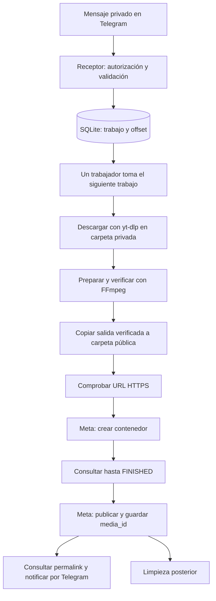

# Arquitectura reproducible: Telegram → Instagram

Fecha: 4 de noviembre de 2026. Este documento define el diseño objetivo. Ya existe una primera implementación Docker en `app/` y `run_bot.py`; su comportamiento, diferencias y despliegue se documentan en [07_DESPLIEGUE_DOCKER.md](07_DESPLIEGUE_DOCKER.md), que prevalece para operar esta versión. El flujo integrado aún requiere una prueba real en el servidor.

## 1. Objetivo y alcance

Un usuario autorizado envía al bot un enlace de Instagram y, opcionalmente, una descripción. El sistema descarga el video, lo prepara con FFmpeg, lo expone mediante HTTPS y lo publica como Reel en una única cuenta de Instagram configurada. El bot informa el progreso y devuelve el enlace publicado.

Todos los usuarios autorizados publican en la misma cuenta de destino; no se selecciona una cuenta por usuario. El MVP publica al procesar el turno, sin programación por fecha, descarga de YouTube ni publicación en YouTube. Los videos deben ser propios o contar con autorización para reutilizarlos.

## 2. Qué existe y qué falta

| Pieza | Estado y evidencia |
|---|---|
| `scripts/check_auth.py` | Autenticación probada con inicio unificado, por ID, en `graph.facebook.com` |
| `scripts/publish_test.py` | Publicación real probada; estados en JSON por prueba |
| `scripts/download_reel.py` | Descarga real confirmada desde el servidor, sin cookies para el Reel probado |
| `scripts/prepare_video.py` | Conversión probada localmente; el usuario informa que funciona en el servidor |
| `scripts/telegram_receive.py` | Recepción probada por el usuario; consulta periódica, mensajes privados y lista JSON |
| `scripts/telegram_users.json` | Lista editable de identificadores permitidos |
| Orquestador y SQLite | Implementados en `app/` y `run_bot.py`; pruebas locales con APIs simuladas |
| Respuestas automáticas de Telegram | Implementadas en el orquestador; el receptor aislado sigue imprimiendo en terminal |
| Publicador reutilizable, cola y recuperación | Implementados; resultados ambiguos requieren revisión manual |
| Exposición de cada nuevo archivo y limpieza | Implementadas; falta verificar montaje y acceso con el Caddy real |

La configuración y estructura de abajo representan el diseño inicial. Para los nombres de variables y módulos efectivamente implementados usa la guía 07; los scripts aislados conservan sus propios argumentos.

## 3. Flujo y responsabilidades



Un solo servicio tendrá un receptor y un trabajador independientes. El receptor hace consultas largas a Telegram y registra trabajos sin esperar las descargas. El trabajador procesa uno a la vez. Así una conversión lenta no impide recibir mensajes nuevos y se limita el consumo de CPU/disco.

La comunicación entre ambos pasa por SQLite, no por una lista exclusivamente en memoria. Cada hilo o componente usa su propia conexión. Se realizan transacciones breves y se evita mantenerlas abiertas durante llamadas de red o FFmpeg. Solo se permite una instancia del servicio; un bloqueo exclusivo de proceso debe impedir arranques duplicados.

## 4. Contrato del mensaje y descripción

Formato aceptado: primera línea no vacía con un único enlace directo de Instagram; las líneas siguientes forman la descripción.

```text
https://www.instagram.com/p/Deu5s_9tTgd/

Esta es la descripción que quiero publicar.
#ejemplo
```

También se aceptan `/reel/CODIGO/` y `/reels/CODIGO/`. Se descartan los parámetros de rastreo al normalizar el enlace. Perfiles, carruseles, fotos, varias URLs en la primera línea o texto antes del enlace se rechazan con instrucciones, sin crear un trabajo publicable.

Regla de selección de descripción:

1. Si hay texto después del enlace, se usa ese texto, quitando únicamente espacios y líneas vacías de los extremos y conservando saltos internos, emojis y hashtags.
2. Si no hay texto o solo espacios, se usa `DEFAULT_REEL_CAPTION`.
3. Si esa variable está vacía, se publica sin descripción.

No se copia automáticamente la descripción del autor del Reel y no se añade un prefijo oculto. La descripción final se guarda al aceptar el trabajo: cambiar `.env` después no altera los trabajos en cola. El MVP aplicará un límite conservador de 2200 caracteres y rechazará excesos sin truncarlos; debe verificar el límite vigente al implementar la llamada a Meta.

`/start` y `/help` explican el formato. Un mensaje normal válido de un usuario autorizado autoriza la publicación automática, sin una segunda confirmación. El texto del mensaje se considera contenido, nunca comandos del sistema.

## 5. Autorización de usuarios

Se mantiene el JSON actual:

```json
{
  "allowed_user_ids": [123456789, 987654321]
}
```

Son IDs numéricos de Telegram, no nombres de usuario. Se relee antes de aceptar cada lote y antes de que el trabajador empiece un trabajo pendiente. Si se retira un usuario, sus trabajos aún no iniciados se cancelan; una petición de publicación ya enviada no puede deshacerse con este cambio.

Un archivo inválido o ausente bloquea la recepción de nuevos trabajos y el inicio de pendientes. El servicio registra el problema y no abre el acceso a todos. Una operación externa ya iniciada debe reconciliarse y registrarse. El receptor actual se detiene ante JSON inválido; la implementación del servicio deberá respetar este cierre de acceso.

## 6. Organización de archivos

Estructura propuesta para Ubuntu; `app/` y `run_bot.py` todavía no existen:

```text
/home/ubuntu/instagram-scheduler/
  .env                         # secretos y configuración, no público
  .venv/
  config/telegram_users.json    # lista para el futuro servicio
  data/jobs.sqlite3            # estado persistente
  data/work/JOB_ID/             # descarga, conversión y temporales privados
  scripts/                     # herramientas actuales de prueba
  app/
    config.py                  # carga y validación
    telegram.py                # recibir y responder
    messages.py                # interpretar enlace y descripción
    repository.py              # SQLite y transacciones
    orchestrator.py            # transiciones y recuperación
    downloader.py              # yt-dlp
    video.py                   # ffprobe y FFmpeg
    hosting.py                 # carpeta pública y URL
    instagram.py               # cliente Meta
    cleanup.py                 # borrado de archivos del trabajo
  run_bot.py                   # futuro punto de entrada

/home/ubuntu/ig-scheduler-files/
  JOB_ID_ready.mp4             # solo salidas verificadas para Meta
```

El descargador actual guarda originales y preparados en `~/ig-scheduler-files`. Durante la integración debe pasar a descargar en `data/work/JOB_ID/` mediante `--output-dir` o una función equivalente. Solo la salida final se copia al directorio público. Tokens, cookies, base de datos y temporales nunca se colocan allí.

La copia pública usa un nombre único por trabajo, se escribe primero fuera del directorio servido y se mueve de forma atómica dentro del mismo sistema de archivos. No se sobrescribe un archivo de otro trabajo. La URL no se reutiliza para contenido diferente.

## 7. Configuración del servicio futuro

Ejemplo de `.env` para el orquestador, no un archivo listo para ejecutar los scripts actuales:

```dotenv
TELEGRAM_BOT_TOKEN=REEMPLAZAR
TELEGRAM_USERS_FILE=/home/ubuntu/instagram-scheduler/config/telegram_users.json
IG_ACCESS_TOKEN=REEMPLAZAR
IG_USER_ID=REEMPLAZAR_CON_ID_NUMERICO
IG_EXPECTED_USERNAME=tula.posting
# Elegir una versión vigente y comprobada antes de arrancar el servicio.
GRAPH_API_VERSION=
DEFAULT_REEL_CAPTION="Mi descripción predeterminada #reels"
WORK_DIR=/home/ubuntu/instagram-scheduler/data/work
DATABASE_PATH=/home/ubuntu/instagram-scheduler/data/jobs.sqlite3
PUBLIC_MEDIA_DIR=/home/ubuntu/ig-scheduler-files
PUBLIC_MEDIA_BASE_URL=https://api.shipisnature.com/ig-scheduler/file
# Opcional; dejar vacío mientras no se necesite una sesión de descarga.
INSTAGRAM_COOKIES_FILE=
```

Las rutas del ejemplo son absolutas. El futuro cargador leerá `.env` desde la raíz del proyecto, sin depender de dónde se ejecute el comando, y dará prioridad a las variables del entorno. Admitirá valores entre comillas, UTF-8 y descripciones de una línea; no interpretará `\n` como salto de línea. Para una descripción de varias líneas se utiliza el mensaje de Telegram.

Los cambios en `.env` requieren reiniciar el servicio. Los cambios válidos del JSON de usuarios no. El arranque debe rechazar tokens vacíos, rutas inseguras y una versión Graph sin configurar; no debe imprimir secretos.

Actualmente solo `check_auth.py` y `publish_test.py` cargan el `.env` raíz. `telegram_receive.py` lee `TELEGRAM_BOT_TOKEN` del entorno o lo pide por terminal; no carga `.env`. El descargador y preparador usan argumentos, no estas variables. `DEFAULT_REEL_CAPTION` todavía no está implementada y `publish_test.py` sigue usando `--caption`.

## 8. Alojamiento HTTPS con Caddy

La correspondencia requerida es:

```text
/home/ubuntu/ig-scheduler-files/JOB_ID_ready.mp4
    → https://api.shipisnature.com/ig-scheduler/file/JOB_ID_ready.mp4
```

Si Caddy corre en Docker, se monta esa carpeta del host en el contenedor, solo para lectura. Ejemplo para adaptar al Compose existente, sin reemplazar toda su configuración:

```yaml
volumes:
  - /home/ubuntu/ig-scheduler-files:/srv/ig-media:ro
```

Dentro del bloque del dominio en el Caddyfile, el diseño propuesto es:

```caddyfile
handle_path /ig-scheduler/file/* {
    root * /srv/ig-media
    file_server
}
```

Esto elimina el prefijo de la URL al buscar el archivo. La configuración debe adaptarse y validarse contra el Caddy existente; este documento no lo modifica ni confirma su montaje. El usuario de Caddy necesita lectura del directorio montado. No se activa listado de directorios.

Antes de pedir a Meta que descargue un archivo, comprobar desde fuera del servidor: HTTPS válido, respuesta 200, `Content-Type: video/mp4`, tamaño coherente y descarga completa sin autenticación ni páginas intermedias. Una comprobación local no demuestra que Meta pueda acceder. `PUBLIC_MEDIA_BASE_URL` es configuración administrada, nunca una URL arbitraria enviada por un usuario.

## 9. Modelo persistente y estados

Tabla `jobs`, campos mínimos:

| Grupo | Campos |
|---|---|
| Identidad | `id` UUID, `update_id` único, `chat_id`, `message_id`, `user_id` |
| Solicitud | `source_url`, `source_shortcode`, `caption`, `ig_account_id`, `graph_version` |
| Estado | `status`, `created_at`, `updated_at`, `attempts`, `last_error`, `retry_at` |
| Archivos | `original_path`, `ready_path`, `public_path`, `public_url` |
| Meta | `container_id`, `container_status`, `media_id`, `permalink` |
| Seguimiento | `notification_status`, `cleanup_status` |

Tabla `settings` para el siguiente offset de Telegram y tabla `events` para cambios de estado con fecha, sin tokens. La inserción del trabajo y el avance del offset se confirman en una misma transacción. Tras reiniciar, se consulta Telegram desde el offset guardado. `update_id` único evita duplicar el trabajo si Telegram entrega otra vez una actualización.

Estados principales:

```text
QUEUED → DOWNLOADING → PREPARING → HOSTING → CREATING_CONTAINER
       → PROCESSING → READY_TO_PUBLISH → PUBLISHING → PUBLISHED
```

Estados adicionales: `RETRY_WAIT`, `FAILED`, `NEEDS_REVIEW`, `CANCELLED`. Notificaciones y limpieza tienen estados independientes: un fallo al enviar el enlace por Telegram o borrar un archivo no convierte una publicación exitosa en un trabajo pendiente de publicar otra vez.

Para el MVP se bloquea además una segunda solicitud del mismo shortcode para la misma cuenta si hay un trabajo activo o ya publicado. Se devuelve su estado/enlace. Reutilizar intencionalmente un Reel quedará para una operación explícita futura. No se promete detectar el mismo contenido subido con otro shortcode.

## 10. Contratos entre módulos

| Operación propuesta | Entrada | Resultado |
|---|---|---|
| `parse_message` | Mensaje, descripción predeterminada | URL normalizada y descripción final |
| `enqueue` | Identidad Telegram y solicitud | Trabajo persistente o duplicado existente |
| `download` | URL, carpeta privada, cookies opcionales | Ruta del original |
| `prepare_video` | Ruta del original | Ruta verificada `_ready.mp4` |
| `expose` | Archivo preparado, ID del trabajo | Ruta pública y URL HTTPS |
| `create_container` | Cuenta, URL y descripción | ID del contenedor |
| `get_container_status` | ID del contenedor | Estado de procesamiento |
| `publish_container` | Cuenta e ID del contenedor | ID de la publicación |
| `get_permalink` | ID de publicación | Enlace del Reel |
| `notify` | Chat y texto | Resultado de entrega |

Son interfaces futuras. `prepare_video` ya existe como función; las otras requieren refactorizar los scripts para devolver resultados estructurados en lugar de interpretar su salida de terminal. FFmpeg se invoca con listas de argumentos, sin construir comandos de shell a partir de mensajes.

## 11. Publicación y recuperación de errores

Se conserva el flujo que funcionó: inicio unificado con token, host `graph.facebook.com`, autenticación por ID y comprobación del usuario esperado. Crear contenedor con `media_type=REELS`, `video_url`, `caption` y `share_to_feed=false`; consultar hasta `FINISHED`; publicar con `creation_id`; guardar `media_id` y consultar `permalink`. La descripción se fija al crear el contenedor, no al publicar.

El trabajador registra la intención antes de cada POST a Meta. Un timeout puede significar que Meta completó la petición sin que el cliente recibiera respuesta. Por tanto:

| Situación | Recuperación |
|---|---|
| Descarga o lectura de estado falla temporalmente | Reintentos limitados con espera creciente |
| Conversión falla | Conservar original, registrar error y no publicar |
| URL pública no accesible | No crear contenedor; revisar hosting |
| Token inválido o falta de permisos | Detener publicación, informar y corregir credenciales |
| Contenedor conocido sigue procesando | Consultar el mismo ID; no crear otro |
| Timeout al crear sin obtener ID | `NEEDS_REVIEW`; no repetir el POST a ciegas |
| Timeout al publicar o reinicio en `PUBLISHING` | Reconciliar el contenedor/cuenta; si no hay certeza, revisión manual |
| `media_id` ya guardado | No publicar otra vez; recuperar permalink y notificar |
| Contenedor `ERROR` o `EXPIRED` | Fallar; un nuevo intento debe ser explícito y comprobado |

No se promete publicación exactamente una vez ante una respuesta remota ambigua. La estrategia evita reintentos peligrosos y preserva evidencia para resolverlos. El orquestador debe fijar un plazo de procesamiento; al agotarse conserva el ID y permite continuar consultas, no reinicia la publicación.

## 12. Notificaciones y limpieza

Mensajes propuestos: «Trabajo recibido: ID», «Descargando», «Preparando video», «Instagram está procesando» y «Publicado: enlace». Los errores incluyen ID y etapa, sin secretos ni trazas completas. No se envía una notificación por cada porcentaje de descarga.

Después de guardar el éxito en SQLite se intenta obtener el permalink y notificar. La limpieza se ejecuta por separado: retirar copia pública y archivos privados del trabajo cuando la publicación esté confirmada. Ante resultados ambiguos, conservarlos para revisión. Los fallos definitivos se retienen inicialmente para diagnóstico; una política de caducidad y límite de disco debe definirse antes de operar de forma permanente.

El borrado se limita a rutas registradas del trabajo, resueltas dentro de `WORK_DIR` y `PUBLIC_MEDIA_DIR`. No se eliminan carpetas completas mediante datos recibidos por Telegram. Los archivos manuales existentes, como `reeltest.mp4`, no pertenecen al trabajo y no se borran.

## 13. Recreación por etapas

1. Crear una app de Meta con el flujo unificado y generar un token para la cuenta correspondiente. Verificar identidad con la guía 03; no intercambiar hosts de autenticación sin comprobar el flujo.
2. Crear el bot con BotFather y guardar su token fuera del directorio público. Usar la guía 05 para obtener IDs y configurar la lista.
3. Preparar Ubuntu con Python 3.11 o posterior, entorno virtual, yt-dlp y FFmpeg/ffprobe. Seguir guía 04 para probar descarga y preparación aisladas.
4. Configurar Caddy y su montaje. Confirmar una descarga HTTPS externa del archivo preparado.
5. Probar publicación aislada con `publish_test.py`, una descripción explícita y un archivo `--state` nuevo. Usar contenido de prueba autorizado; no volver a publicar el Reel ya probado accidentalmente.
6. Implementar los módulos y SQLite descritos arriba. Copiar configuración privada, fijar versión Graph y comprobar rutas/permisos al arrancar.
7. Probar el orquestador inicialmente con una cuenta autorizada y un solo trabajo; luego con varios usuarios y cola.
8. Solo cuando el flujo y la recuperación estén verificados, instalar un servicio systemd con usuario sin privilegios, directorio del proyecto y carga segura de secretos. El futuro comando será `.venv/bin/python run_bot.py`; todavía no existe.

No ejecutar el receptor aislado a la vez que el orquestador usando el mismo bot. Al pasar al servicio se detiene el primero. Las versiones exactas de Python, yt-dlp y FFmpeg se registrarán en el despliegue; actualizar yt-dlp se hará de forma controlada y con una prueba de descarga posterior.

## 14. Criterios de aceptación

- Un usuario permitido envía enlace y descripción y recibe el permalink correcto.
- Un enlace sin descripción usa el valor de `.env`; si ambos están vacíos, no añade texto.
- Usuario no permitido, JSON inválido y mensaje mal formado nunca disparan una publicación.
- Un video horizontal conserva su proporción; la salida preparada se verifica antes de exponerse.
- Dos usuarios envían trabajos mientras FFmpeg está ocupado y ambos quedan registrados.
- Una actualización repetida y un shortcode ya registrado no generan otra publicación.
- Reinicios durante descarga, procesamiento y después del éxito retoman el estado adecuado.
- Una respuesta ambigua en creación/publicación queda en revisión, sin reintento ciego.
- Fallos de notificación o limpieza no vuelven a publicar el video.
- Secretos y archivos privados no son accesibles mediante Caddy ni aparecen en logs.

## 15. Documentación relacionada

- [03 — Estado validado y operación](03_ESTADO_VALIDADO_Y_OPERACION.md): evidencia de autenticación y publicación real, IDs y comandos de prueba.
- [04 — Descargar y preparar en el servidor](04_DESCARGAR_REEL_EN_SERVIDOR.md).
- [05 — Recepción de Telegram y usuarios](05_TELEGRAM_RECEPCION.md).
- Las guías 01 y 02 contienen el diseño inicial; para el orquestador descrito aquí prevalece este documento.
- [Telegram Bot API](https://core.telegram.org/bots/api): recepción y respuestas.
- [Meta: colección oficial de Instagram](https://www.postman.com/meta/instagram/documentation/6yqw8pt/instagram-api).
- [yt-dlp](https://github.com/yt-dlp/yt-dlp) y [FFmpeg](https://ffmpeg.org/documentation.html).
